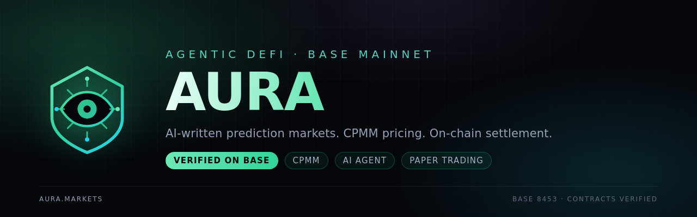
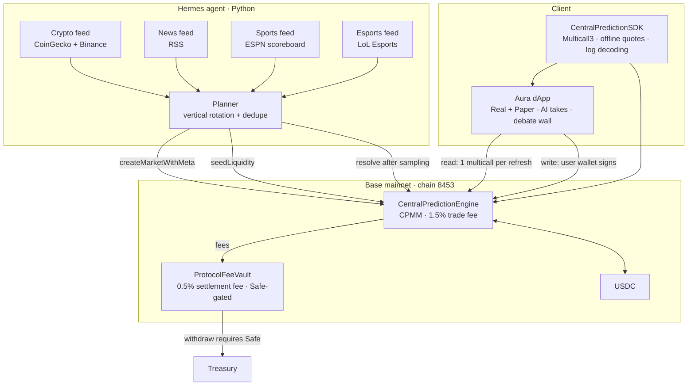
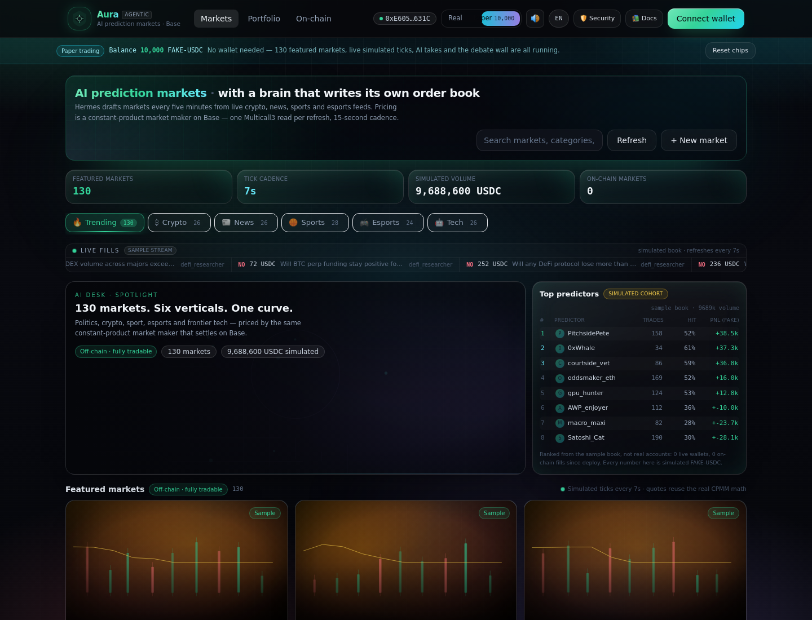
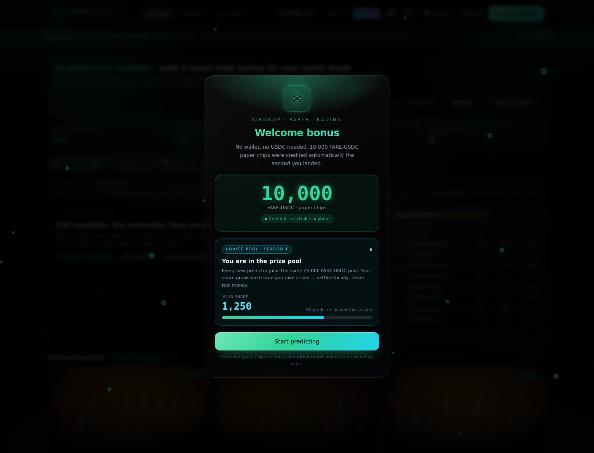

<p align="center">
  
</p>

<h1 align="center">Aura</h1>

<p align="center">
  <b>An agentic prediction market.</b> An AI writes the markets, a constant-product market maker prices them,
  and a dispute window settles them — on Base mainnet, in USDC.
</p>

<p align="center">
  <a href="https://github.com/PeaceCoin10/Aura-AI-Prediction-Market/actions"></a>
  <a href="https://basescan.org/address/0xE6056Bc6700F6d7E6fF8779B212655284dc1631C#code"></a>
  
  
  
  
</p>

<p align="center">
  <a href="https://peacecoin10.github.io/Aura-AI-Prediction-Market/"></a>
</p>

<p align="center">
  <sub>130 sample markets across politics, crypto, sport, esports and frontier tech · 10,000 FAKE-USDC on arrival · no wallet needed to look around</sub>
</p>

<p align="center">
  <a href="https://peacecoin10.github.io/Aura-AI-Prediction-Market/"><b>Live app →</b></a> ·
  <a href="#the-cold-start-problem-solved-mechanically">Why</a> ·
  <a href="#architecture">Architecture</a> ·
  <a href="#contracts">Contracts</a> ·
  <a href="#economics">Economics</a> ·
  <a href="#quickstart">Quickstart</a> ·
  <a href="#sdk">SDK</a> ·
  <a href="#security">Security</a> ·
  <a href="#deploy">Deploy</a>
</p>

---

## The cold-start problem, solved mechanically

Prediction markets die on a three-way chicken-and-egg: no markets means no traders, no traders means no
liquidity, no liquidity means no markets. Most teams answer that with incentives. Aura answers it with software.

| Problem | Mechanism | Where |
| --- | --- | --- |
| **Who writes the markets?** | A Hermes agent cycle polls CoinGecko/Binance, RSS, ESPN and LoL Esports every 5 minutes and drafts a binary market with an explicit resolution rule | `hermes/hermes_brain.py`, `hermes/verticals.py` |
| **Who prices them?** | A constant-product market maker on-chain — `p_yes = noReserve / (yesReserve + noReserve)`. No order book, no market maker to hire | `src/CentralPredictionEngine.sol` |
| **Who settles them?** | Price markets: 3×30s sampling to resist wicks. Sports/esports: official results only. News: **never auto-resolved** — routed to a Safe | `OracleEngine` |
| **What about first-time users?** | Paper mode: 10,000 FAKE-USDC credited on arrival, 130 sample markets across six verticals, quoted with the same CPMM maths and settled locally | `frontend/src/lib/paper.ts` |
| **Can settlement be gamed?** | 1-hour dispute window after resolution, withdrawals locked, Safe multisig can override | `DISPUTE_WINDOW = 1 hours` |
| **Can the admin run away?** | After 7 days unsettled, anyone can call `emergencyRefund` for a full refund | `REFUND_DELAY = 7 days` |

> **AI supplies the content, the AMM supplies the liquidity, the dispute window supplies the correction,
> and paper trading supplies the users.**

---

## Architecture



<details>
<summary>ASCII version</summary>

```
┌──────────────────────────────────────────────────────────────────────────────┐
│  Aura · Agentic prediction market                                            │
│                                                                              │
│   ┌──────────────┐      ┌──────────────┐      ┌──────────────┐               │
│   │   Creator    │      │    Oracle    │      │ Distribution │               │
│   │ market draft │      │ sample/result│      │ share cards  │               │
│   └──────┬───────┘      └──────┬───────┘      └──────┬───────┘               │
│          └──────────── Hermes agent (5 min) ─────────┘                       │
│                                    │ cast / RPC                              │
│                                    ▼                                         │
│   ┌───────────────────────────────────────────────────────────────┐          │
│   │  CentralPredictionEngine (Solidity 0.8.24, CPMM, 1.5% fee)    │          │
│   │  createMarket · buyShares · sellShares · resolve · redeem     │          │
│   └───────────────┬───────────────────────────────┬───────────────┘          │
│                   │ 0.5% settlement               │ 1.5% trade              │
│                   ▼                               ▼                          │
│          ┌──────────────────┐          ┌────────────────────┐               │
│          │ ProtocolFeeVault │◀─────────│   USDC (Base)      │               │
│          └──────────────────┘          └────────────────────┘               │
│                   ▲                                                          │
│   ┌───────────────┴───────────────┐        ┌──────────────────────────┐      │
│   │  CentralPredictionSDK (TS)    │◀──────▶│  dApp (Vite + React)     │      │
│   │  Multicall3 · offline quotes  │        │  Real / Paper · AI takes │      │
│   └───────────────────────────────┘        └──────────────────────────┘      │
└──────────────────────────────────────────────────────────────────────────────┘
```
</details>

---

## Contracts

Base mainnet · chainId **8453** · settled in USDC (6 decimals)

| Contract | Address | Status | Verification |
| --- | --- | --- | --- |
| `CentralPredictionEngine` | [`0xE6056Bc6700F6d7E6fF8779B212655284dc1631C`](https://basescan.org/address/0xE6056Bc6700F6d7E6fF8779B212655284dc1631C#code) | live | Etherscan V2 API, exact match, solc 0.8.24, MIT |
| `ProtocolFeeVault` | [`0x29dE563f3059827D00837305FAE2Bbc87c7D9eE1`](https://basescan.org/address/0x29dE563f3059827D00837305FAE2Bbc87c7D9eE1#code) | live | same |
| `USDC` | [`0x833589fCD6eDb6E08f4c7C32D4f71b54bdA02913`](https://basescan.org/address/0x833589fCD6eDb6E08f4c7C32D4f71b54bdA02913) | — | canonical token |

Constructor arguments — reproducible, no proxy, no upgrade path:

```
CentralPredictionEngine(usdc, feeVault, admin, creator)
  = (0x8335…2913, 0x29dE…9eE1, 0x436b…5Ba1, 0x436b…5Ba1)

ProtocolFeeVault(usdc, admin, treasury)
  = (0x8335…2913, 0x436b…5Ba1, 0x436b…5Ba1)
```

Source check that does not trust this README:

```bash
curl -s "https://api.etherscan.io/v2/api?chainid=8453&module=contract&action=getsourcecode\
&address=0xE6056Bc6700F6d7E6fF8779B212655284dc1631C&apikey=$ETHERSCAN_API_KEY" \
  | jq -r '.result[0].ContractName'
# → CentralPredictionEngine
```

Bytecode/source consistency is also `exact_match` on Sourcify (1798 B / 13196 B, differing only in immutable slots).

---

## Economics

### Price is a reserve ratio

Each market holds two USDC reserves: `Y` (YES) and `N` (NO). **The price of YES is the NO share of the pool.**

```
p_yes = N / (Y + N)        p_no = Y / (Y + N)        p_yes + p_no = 1
```

Buying YES grows `Y`, which raises `p_yes` — the same intuition as betting odds, without needing a counterparty.

### What one buy gets you

The 1.5% fee is taken first, then the net amount moves the curve while `Y·N` is held (approximately) constant:

```
fee    = ceil(amountIn × 150 / 10000)          // 1.5%, rounded up in the protocol's favour
net    = amountIn − fee
Y'     = ceil(Y × N / (N + net))                // YES reserve consumed by the buy
shares = net + (Y − Y')                         // shares are USDC-denominated, 6 decimals
```

Selling mirrors it: shares are burned, reserves restored, proceeds net of the fee. Every quote can be computed
**offline** — `previewBuyOffline` / `previewSellOffline` in the SDK are wei-for-wei identical to the on-chain
path, which is what makes paper trading honest rather than a mock.

### Where the money goes

| Flow | Rate | Destination |
| --- | --- | --- |
| Trade fee | 1.5% of notional | `ProtocolFeeVault` |
| Settlement fee | 0.5% of the losing side | `ProtocolFeeVault` |
| Vault withdrawal | — | requires a Safe signature |
| Emergency | after 7 days unsettled | `emergencyRefund` → full refund to holders |

---

## Quickstart

```bash
git clone https://github.com/PeaceCoin10/Aura-AI-Prediction-Market.git
cd Aura-AI-Prediction-Market

# contracts
forge test                                              # 46 tests

# SDK (offline unit tests, no RPC needed)
cd sdk && npm install && npm test && cd ..               # 70 tests

# agent
python3 -m unittest discover -s hermes -p 'test_*.py'    # 49 tests

# dApp
cd frontend && npm install && npm run dev
# → http://127.0.0.1:5173   paper mode by default: 10,000 FAKE-USDC, no wallet
```

End-to-end suites:

```bash
cd frontend
python3 scripts/e2e_ui.py        # 55 headless UI assertions
python3 scripts/shots.py         # regenerate README screenshots
python3 scripts/e2e_local.py     # 11 real-chain assertions against anvil (see docs)
```

<details>
<summary>Screenshots (generated by <code>scripts/shots.py</code>)</summary>

| | |
| --- | --- |
|  |  |
| Market hall — 130 sample markets, artwork, live ticker and leaderboard | Novice pool — the second beat of onboarding |

</details>

---

## SDK

```ts
import { CentralPredictionSDK, parseUnits } from "@aura/prediction-sdk";

const sdk = new CentralPredictionSDK({
  rpcUrl: "https://mainnet.base.org",
  engine: "0xE6056Bc6700F6d7E6fF8779B212655284dc1631C",
});

// One RPC round-trip for the whole board (Multicall3 aggregate3)
const ids = await sdk.allMarketIds();
const markets = await sdk.marketSnapshots(ids, { withMeta: true });

// Offline quote — identical maths to the contract, zero RPC
const shares = sdk.previewBuyOffline(markets[0], /* outcome */ 1, parseUnits("25", 6));

// Real trade: build, then send with the user's wallet
const tx = sdk.buildBuyShares({
  marketId: markets[0].marketId,
  outcome: 1,                       // 0 = NO, 1 = YES  (contract order — not UI order)
  amountIn: parseUnits("25", 6),
  minSharesOut: (shares * 99n) / 100n,
  recipient: account,
});
await wallet.sendTransaction(tx);

// Decode what actually happened
const logs = sdk.decodeReceiptLogs(receipt.logs);
```

> **Outcome encoding caveat:** the contract uses `0 = NO, 1 = YES`; the UI's side index is the reverse
> (`0 = YES`). The mapping lives in exactly one place — `frontend/src/lib/paper.ts` — and is covered by tests.

---

## Security

| Layer | Result |
| --- | --- |
| Static analysis (Slither 0.10.0) | **0 High, 0 Medium**, 12 Low (`block.timestamp`, intended), 7 Informational |
| Invariant testing | 512 runs × depth 200 = **102,400 handler calls, 0 invariant breaks** |
| Unit + integration | 46 forge tests |
| Settlement | 3×30s sampling for price markets; official results only for sports/esports; news never auto-resolves |
| Dispute | 1-hour window, withdrawals locked, Safe multisig can override resolution |
| Escape hatch | after 7 days unsettled → permissionless `emergencyRefund` |

Raw Slither JSON: [`docs/security/slither-report.json`](docs/security/slither-report.json).
**No audit has been performed.** Static analysis is not an audit.

---

## Deploy

Live now at **https://peacecoin10.github.io/Aura-AI-Prediction-Market/** (GitHub Pages, HTTPS, permanent).

```bash
# permanent static host, one command each
GITHUB_TOKEN=ghp_xxx ./deploy/gh-pages.sh       # → https://<owner>.github.io/<repo>/   (default)
VERCEL_TOKEN=xxx     ./deploy/vercel.sh         # → https://<project>.vercel.app
NETLIFY_TOKEN=xxx    ./deploy/netlify.sh --build # → https://<site>.netlify.app (pure REST, no CLI)

# publish this repo to GitHub with a PAT (no browser session needed)
GITHUB_TOKEN=ghp_xxx ./scripts/github_push.sh   # add --force to rewrite remote history
```

`deploy/gh-pages.sh` builds with `--base=/<repo>/`, publishes an orphan `gh-pages` branch (with `404.html`
and `.nojekyll`), enables Pages over REST, polls until the build is live, then verifies the page **and** the
hashed bundle return 200.

CI is kept at [`docs/ci.yml`](docs/ci.yml): copy it to `.github/workflows/ci.yml` once your token has the
`workflow` scope (a `public_repo`-only token is refused for workflow files by design).

Both hosts build the whole repo (`cd frontend && npm run build`), so the `@sdk` path alias resolves.
The agent is a long-running Python process — it is not part of the static deployment.

Guides: [`docs/GITHUB-PUSH.md`](docs/GITHUB-PUSH.md) · [`docs/DEPLOY-PERMANENT.md`](docs/DEPLOY-PERMANENT.md) ·
[`docs/ASSETS.md`](docs/ASSETS.md)

---

## Repository layout

```
src/                Solidity: engine, fee vault, CPMM library
test/               forge tests + invariant handlers
sdk/                TypeScript SDK (Multicall3, offline quotes, log decoding)
hermes/             agent: planners, verticals, insights writer
frontend/           dApp (Vite + React + Tailwind + viem)
  src/locales/en/   message tree — one namespace per surface
deploy/             gh-pages / vercel / netlify / tunnel / basescan verification
scripts/            github_push + repo tooling
docs/               engineering notes, security matrix, deploy guides
assets/             brand: logo, banner
```

---

## Roadmap

- [ ] Fund the agent wallet (≥100 USDC) so it seeds markets on mainnet automatically
- [ ] Move the debate wall off `localStorage` (indexer or on-chain)
- [ ] Hand `admin` to a Safe multisig (currently a single EOA)
- [ ] Independent audit
- [ ] More locales — the i18n runtime is namespace-based; add one file under `frontend/src/locales/`

---

## Disclaimer

Aura is experimental software. Markets are resolved by an oracle with a dispute window; the operator can
override a resolution during that window. Nothing here is investment advice. Prediction shares can go to
zero. Use only what you can afford to lose, and check that prediction markets are legal where you live.

<p align="center"><sub>MIT licensed · built on Base · the AI writes, the curve prices, the chain settles</sub></p>
